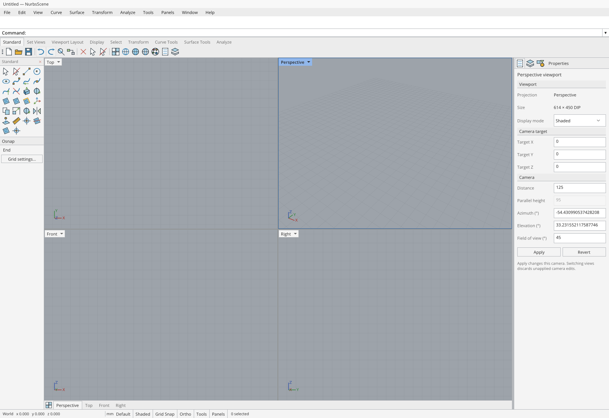
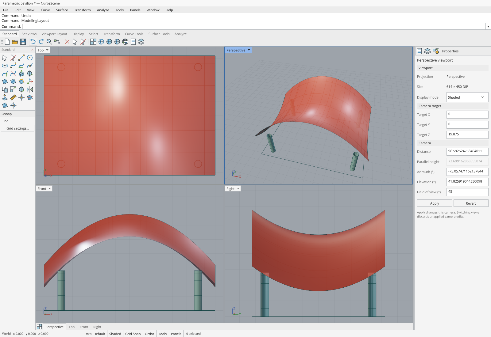
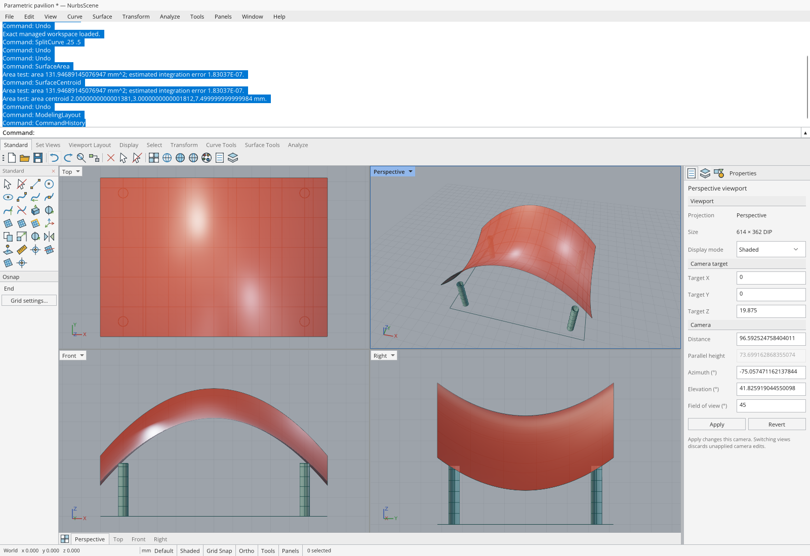

# Rhino command area and desktop fidelity refinement

## Motivation and reference

The November 13 user capture shows clipped command-history lines, rendering-backend
messages occupying the command band, a large bold prompt beside a taller input,
and toolbar/tab styling that still differs visibly from Rhino's desktop layout.
The previous UI qualification replaced startup history with a synthetic banner,
so its passing result did not establish that ordinary startup looked correct.

This follow-up refines the actual Uno workspace, with particular attention to the
command area. Reference material is McNeel's Windows desktop documentation:

- [Rhino 8 window and command area](https://docs.mcneel.com/rhino/8/help/en-us/user_interface/rhino_window.htm)
- [Rhino command appearance](https://docs.mcneel.com/rhino/8/help/en-us/options/appearance.htm)
- [Command history](https://docs.mcneel.com/rhino/8/help/en-us/commands/commandhistory.htm)
- [Rhino Windows interface introduction](https://www.rhino3d.com/it/docs/guides/modeling/rhino-windows-interface-introduction/)

The target is the compact Windows arrangement: a continuous white command
surface, two complete history lines, a small inline prompt and aligned input,
neutral toolbar tabs, flat icon cells, pale active viewport titles and a darker
gray modeling background. Reference images are not bundled. Existing authored
icons and executable controls remain in use. This changes presentation and input
fidelity; it does not imply complete Rhino command or format compatibility.

## Command-area implementation

`CommandConsole` uses one selectable native `TextBlock` inside one native
`ScrollViewer`, plus the existing native `AutoSuggestBox` command editor. The
history, prompt and input share a 12 DIP type size. The prompt is semibold;
history and input are regular weight. There is no placeholder in the live input.

| Element | Layout |
| --- | --- |
| Compact history | 32 DIP viewport: two 16 DIP line boxes |
| Expanded history | 208 DIP viewport: thirteen 16 DIP line boxes |
| Live prompt/input | 20 DIP, with a separate one-DIP divider above |
| History layout | `BlockLineHeight`, wrapping, no vertical padding |
| History scrolling | Vertical native scrollbar; horizontal scrolling disabled |
| History toggle | Small 18 DIP-wide up/down control at the right edge |

Styling the outer `AutoSuggestBox` alone was insufficient: its inner `TextBox`
retained independent minimum height, padding and focused-border resources. A
scoped `TextBoxStyle` and scoped text-control resources now size the real editor.
The native editing, IME, completion, caret, selection and accessibility behavior
remain available.

History echoes use `Command: <command>`. The controller's existing message
protocol is unchanged. The active Line command displays `Start of line:` and then
`End of line:` from the real construction anchor; completing or canceling returns
to `Command:`. Startup no longer inserts the product banner or routine device and
frame-submission messages. Rendering details remain available through diagnostics
and the status tooltip; a new rendering error still reaches history and the
viewport error overlay.

### Selection, scrolling and lifetime

Native pointer selection and Ctrl/Command+A/C operate on the displayed history.
The context menu provides Copy, Copy all, Select all and Clear history. Incoming
ordinary output updates the logical transcript but leaves a selected displayed
snapshot untouched. Starting a new command or returning focus to the input
deliberately resumes the live transcript.

The console follows appended output only while the reader is at the tail.
Queued appends do not suppress native reader scrolling. Extent changes and F2
resizing preserve that reading intent; completed text layout refreshes cached
viewport/extent measurements even when no offset-change event is raised. Native
wheel motion can begin on a later frame, so a passive handled-event observer
records an actual in-range vertical wheel gesture immediately. It neither handles
the event nor changes its offset, preserving native scrolling and edge chaining.
It also invalidates an older queued snap before that callback can stop the new
gesture. Settled offsets snap to complete visual lines, including wrapped results;
snapping onto the actual tail resumes following.

Dispatcher callbacks are coalesced and guarded by the load generation. Unload
invalidates pending layout work and unregisters the selected-text dependency
property callback. The pinned Uno version's generated `SelectionChanged` event
is unimplemented, so selection notification uses the working
`TextBlock.SelectedTextProperty` callback instead.

The transcript is bounded to 500 physical lines, with a 4096-character truncation
threshold per incoming message, normalized newlines and surrogate-safe truncation. Existing
command recall, draft restoration, completion, repeat and the deferred
canvas-to-command input handoff are retained.

Actual native recall exposed a pre-existing asynchronous editing race. Uno can
deliver a programmatic `TextChanged` after the synchronous setter returns, and
the outer `AutoSuggestBox.Text` can trail the visible editor. Recall now snapshots
the real inner `TextBox.Text`; text assignment synchronizes both values even when
the outer dependency property already equals the requested string. Completion
responds to current `UserInput` events, retains explicit assignment intent across
equal-value pending events, and stays closed during history navigation. Canvas
typing still populates completion explicitly after native focus transfers. The
existing immediate Up/Down test retains its complete unsent-draft expectation.

## Surrounding desktop presentation

The menu row is 22 DIP, the toolbar categories 23 DIP and the icon row 30 DIP.
The native menu template's own button padding and four-DIP item margins are
compacted too; reducing only the outer row clipped the menu text in the first
real startup capture. Workspace-wide keyboard accelerators use hidden tooltip
placement, preventing a Ctrl+S tooltip from appearing over the menu when the
pointer rests on the root surface. The accelerators themselves remain active.
Toolbar icons share a continuous background, with cell borders appearing during
interaction. Selected tabs have a restrained raised outline without the previous
blue underline. Toolbar, category, viewport-tab and status strips use native
horizontal scrolling without reserving a scrollbar inside their compact rows;
keyboard focus, touch, horizontal wheel input and trackpads remain supported.
An unmodified vertical wheel moves an overflowing strip only when it can move.

Viewport title groups are 20 DIP high, sit one DIP from the pane edge and use
dark text on a pale-blue active fill. Sidebar headings, icon spacing and status
buttons are smaller and neutral. The title-row marketing label and redundant
keyboard-help captions are removed. Existing panel visibility, docking and layout
preferences are preserved.

The C# and JavaScript WebGPU renderers now share a linear HDR clear of
`(.224357, .244384, .270711, 1)`. Through the unchanged ACES/sRGB compositor at
exposure 1, this resolves to approximately `#9DA3AA`, matching the reference's
gray viewport. Their default minor-grid sRGB input is
`(.448172, .465350, .486168, .48)`, producing approximately `#949AA1` at full line
coverage over that background. The JavaScript major/axis colors and supplied
custom colors remain distinct. Shader algorithms, render passes, resource
caching and geometry are unchanged; exposure settings still affect the output.

## Qualification improvements

The existing `rhino-workspace` campaign now captures ordinary startup **before**
loading any modeling fixture. It records the actual empty document and graph,
first submitted GPU frame, command history, preferences and native layout. It
also captures startup after reload before the fixture can change persisted state.
The old synthetic history reset/banner is removed.

The startup checkpoint is read-only except for a bounded acknowledgment that
releases the existing fixture. It adds no command, geometry, focus or input
mutation API. Only the existing Rhino campaign opts into it. Both startup
JSON/PNG pairs are required by the artifact gate.

The first attempts also exposed a presentation boundary: CAD submissions can
precede Uno's loading-screen removal. The pinned host removes its splash after
font preload, layout and a composition frame. Startup capture now waits for the
actual loader nodes to disappear and the connected `uno-canvas` to be visible
with positive CSS/backing dimensions. It crosses two browser animation callbacks,
then requires two newer passive native samples before its single screenshot.
Measured host state and frame timestamps are saved and required by the artifact
gate. No redraw, screenshot retry, artificial delay or application mutation is
used to obtain the expected image; the independent checkpoint timeout remains.

Passive command observations inspect actual native bounds, desired sizes,
`TextBlock.BaselineOffset`, font metrics, line height, selection and scrollbar
viewport/extent/offset values. The inner AutoSuggestBox `TextBox` and its rendered
text descendant are measured directly. No character rectangle or expected
baseline is synthesized. Empty text has no painted baseline; populated command
recall and restored drafts must align their real baseline with the prompt.

The first hosted startup run confirmed matching painted prompt/input baselines,
but exposed a native bounds detail: Uno's `TextBlock.ActualWidth` returns desired
width including margins, while its transformed origin already includes the left
margin. Prompt spacing now belongs to a padded parent with a margin-free text
child. This preserves the visible three-DIP gap and lets the unchanged native
spacing assertion measure the actual text width. Margin values are also retained
in passive diagnostics; no tolerance was enlarged to accept the initial failure.

The campaign grows from 64 to 71 checks. Across the same eleven campaigns, the
minimum is now **414 native UI checks**. Existing behaviors remain covered;
history copying additionally requires the complete native selection and exact
clipboard transcript, and point-entry checks require the actual prompt
transitions. The 33 modeling/framebuffer checks in every campaign remain intact.

Local verification passed 59 observation contracts, 60 artifact-gate contracts
and eight existing JavaScript WebGPU contracts. Source whitespace checks pass.
The local native compilation reached Uno resource injection with no C# warnings;
the full build stopped at the environment's `EmbeddedResourceInjectorTask`
MSB4216 task-host failure. Hosted desktop/browser builds and actual native-input
captures are therefore required for acceptance; local compilation is not being
reported as a complete application build.

## Acceptance record

The complete implementation passed **all 23 repository workflows** and **all 15
Uno jobs** in [run 43409888630](https://github.com/wieslawsoltes/NurbsScene/actions/runs/43409888630).

| Identity | Accepted value |
| --- | --- |
| Application/test source | `a31a3a6041b08dd7b9ee5ac4d10365b1d54672e6` |
| Tested PR merge | `8de11424b02ee0c4c89230f5a739fb57c0e630d8` |
| Tested tree | `76bbde8fc798e02a9c5631cebd8d79e73392a824` |
| Aggregate artifact | `14030425540` / 22,171,098 bytes |
| Artifact SHA-256 | `02b3cbee956d21071a4830f4a04929e48d03eadb770ef1bfd00fdbc077537c7b` |
| Publication | 849 files; identical manifests in every campaign |

The aggregate records **414 passed UI checks across eleven campaigns**, including
all **71 Rhino command/navigation checks**, and **33 modeling/framebuffer checks
in each campaign**. The thirteen browser device lifetimes, including both
pre-/post-reload pairs, each recorded one device and three fulfilled readbacks,
with zero dropped maps, GPU errors or browser-page errors. Native desktop passed
40 runtime checks and ten WebGPU contracts on software Vulkan, closed normally,
and compiled with zero warnings and errors. These are software-GPU correctness
results; they do not measure physical-GPU throughput.

Both ordinary-startup captures have a visible 1600 × 1100 host canvas, no loader,
empty document/graph/history and two CAD submissions. Measured geometry is a
20 DIP input row, a 32 DIP compact history viewport, 16 DIP line height, 12 DIP
prompt/editor fonts and a three-DIP text-to-input gap. The expanded 208 DIP
history, exact native clipboard transcript, immediate Up/Down draft restoration
and populated-text baseline alignment all passed their unchanged assertions.

The [machine-readable acceptance record](RHINO-COMMAND-AREA-EVIDENCE.json) preserves
artifact hashes, per-campaign results, native desktop evidence, host presentation
measurements and screenshot hashes. The following documentation commit only
records this accepted source and its captures; application, test, dependency and
workflow source remain unchanged. Every subsequent revision still runs its own
complete gate before merge/deployment.

### Actual application captures

These are untouched PNG bytes from the accepted aggregate artifact, verified
against the individual Rhino campaign artifact as well. They are not mockups or
replacement browser markup.

Ordinary startup, before any modeling fixture:

Populated compact history with two complete lines above the live prompt:

Expanded native history after selecting and copying the entire transcript:

The separate [startup-after-reload capture](images/rhino-command-area/uno-rhino-startup-reload.png)
records restored layout/rendering preferences before the fixture loads again.
