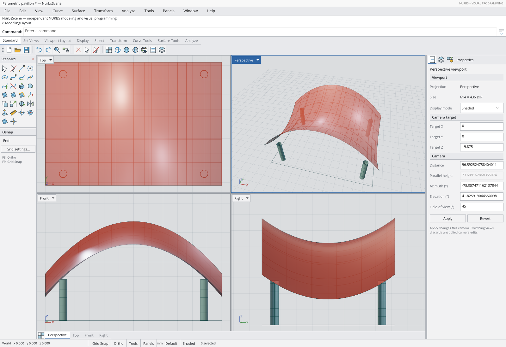
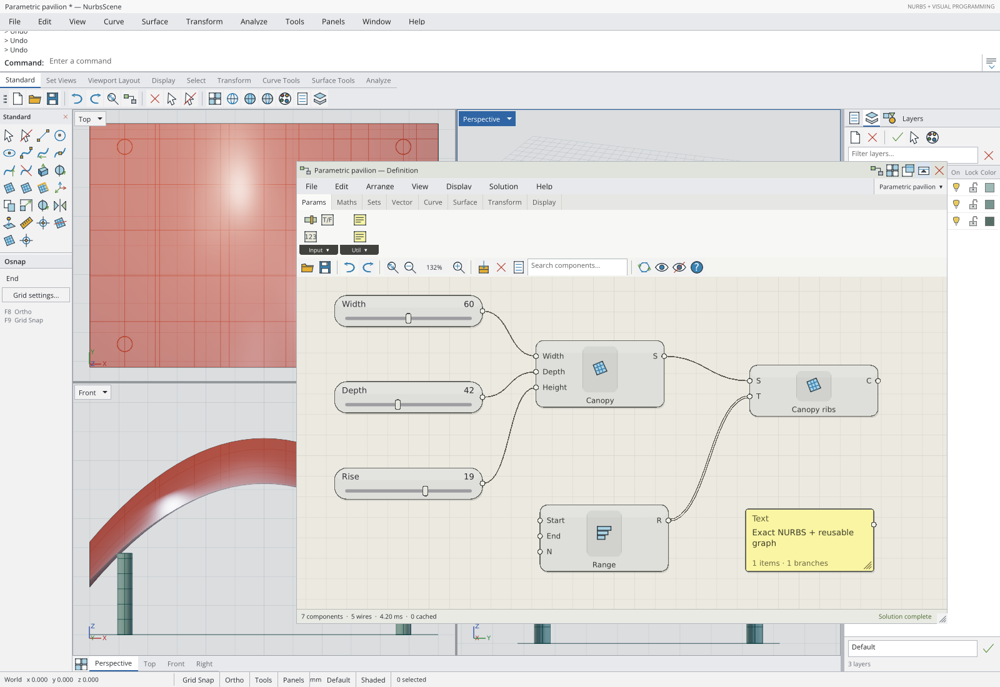
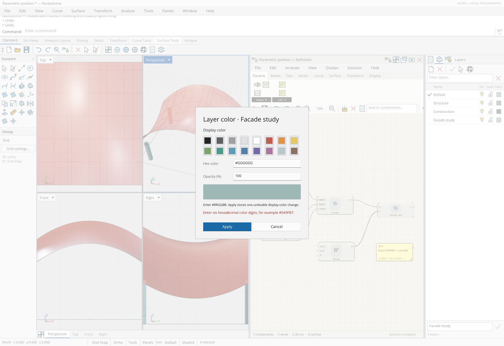

# Rhino-style modeling and Grasshopper-style definition workspace

This follow-up to the Uno 7 / WebGPU migration implements the compact desktop
organization of Rhino 8 and the visual language of the classic Grasshopper
editor using NurbsScene's own controls, vector artwork and executable commands.
The work is tracked in [PR #19](https://github.com/wieslawsoltes/NurbsScene/pull/19).

## Reference and scope

The primary references are McNeel's [Rhino window guide](https://docs.mcneel.com/rhino/8/help/en-us/user_interface/rhino_window.htm),
[toolbar/container guide](https://docs.mcneel.com/rhino/8/help/en-us/user_interface/using_toolbars.htm),
and [Grasshopper interface description](https://www.grasshopper3d.com/profiles/blogs/interface-explained).
They inform layout, density, grouping, selection feedback and discoverability.
Rhino's proprietary artwork, application binaries and plugin APIs are not used.

This change covers the modeling shell, command area, categorized toolbars and
linked sidebar, viewport controls, status strip, Properties/Layers/Objects
container, and definition window, palettes, menus, toolbar and canvas styling.
Every advertised modeling/component action continues to use the real document or
graph. The exact geometry model and shared-device WebGPU renderer remain the
production paths. There is no screenshot overlay or parallel mock interface.

## Modeling workspace

| Area | Implemented behavior | Ownership |
|---|---|---|
| Desktop chrome | Consistent 12 DIP native-control defaults, square compact controls, neutral surfaces, section rules, selected-tab accents and original vector icons | `ClassicChrome`, `WorkbenchIcon` |
| Command band | White selectable history above the command prompt; retained expand/collapse icon; compact/expanded history remains 38/220 DIP; F2, recall, repeat, copy and canvas typing preserved | `CommandConsole` |
| Toolbar containers | Standard, Set Views, Viewport Layout, Display, Select, Transform, Curve Tools, Surface Tools and Analyze tabs; real file/history/definition commands remain accessible | `ModelToolbar`, `WorkspaceCommands` |
| Modeling sidebar | Four icon columns in a 116 DIP container; active toolbar category changes the presented tool page; common selection actions remain available; Osnap and grid settings live below the tools | `WorkspaceChrome` |
| Viewports | Four retained native title/dropdown controls; blue active title and frame; neutral inactive titles; single click activates and double click maximizes/restores; view tabs remain at the bottom | `ViewportControl`, `ViewportOverlay` |
| Status strip | Segmented coordinates, grid snap, Ortho, sidebar/panel visibility, units, active/selected layer, display mode and selection status | `WorkspaceView`, `WorkspaceShell` |

Toolbar and sidebar pages are retained by category. Returning to a visited page
reattaches its existing controls, preserving native identity and avoiding rebuilds
on each tab change. Category selection changes neither model nor graph history.
Only categories with implemented command coverage are advertised; absent Rhino
Solid/SubD/annotation commands are not represented by inert controls.

The shell additionally handles `FloatingDefinition`, `FoldDefinition`,
`ViewTop`, `ViewFront`, `ViewRight`, `ViewPerspective` and `Rendering`.
Existing commands and automation identifiers retain their meaning.

## Properties, layers and objects

The right-side container keeps its 250 DIP default width and persistent splitter.
Compact icon tabs select Properties, Layers or Objects, with a clear panel heading.
Camera and selected-object properties use aligned label/value rows and section
headers. Camera drafts remain atomic: invalid values do not modify live cameras.

Layers use retained, virtualized rows with current, visibility, lock and display
color columns. The panel provides a case-insensitive filter, clear-filter control,
new-layer action, selected-layer name editor, current-layer action and object
selection by layer. Visibility, locking, naming and color changes are ordinary
undoable document transactions. Nonstructural changes update the existing rows.
The Objects list presents object type, layer/status and color without replacing its
item source for nonstructural updates.

The native color editor validates its hex draft and preserves alpha. Applying an
unchanged displayed color preserves the original floating-point channels, rather
than quantizing the document through an 8-bit hex round trip. Object colors still
inherit their layer unless the user makes an actual override. The callback checks
the originating document, object/layer identity and effective inherited color;
a stale dialog cannot silently overwrite a changed source. A layer-name draft is
retained only while the same row remains selected, preventing a removed layer's
draft from renaming its fallback selection.

## Definition editor

The editor now has a document title and File/Edit/Arrange/View/Display/Solution/Help
menus, grouped component palette, compact canvas toolbar and solution status bar.
The File menu and document selector route Open/Save/Save As through the host's
existing `.nscene` workspace pickers. Recompute runs the real graph session with
cancellation on graph replacement/disposal. Help describes implemented controls.

Each component category presents two rows of original vector buttons organized by
meaningful subgroups such as Input/Util, Operators/Trig/Polynomials,
Tree/List/Sequence, and Primitive/Spline/Analysis. Dark group footers open native
flyouts containing the complete group with component labels. All registered
components remain reachable through their palette group and executable search.
Visited pages and buttons are cached. Replacing a graph with another component
registry refreshes the shelf even when the `GraphSession` itself is retained.

The WebGPU graph canvas uses neutral capsules, green selection feedback,
orange blocked state and red error state, with disabled and preview states kept
distinct. Port strips, clipped labels and component icons improve legibility.
Scalar, list and tree wires retain their real data/port endpoints and cached paths.
Grid, icons, names and fancy-wire display toggles invalidate drawing only; they do
not edit graph state or rebuild node geometry. Existing panel typography, scrolling,
resizing, slider editing, hit testing and pointer transforms are preserved.

## Floating, folding and docking

Use the definition title controls to dock right, dock below, float, fold/unfold or
hide the editor. Floating reparents the same editor and `GraphSession`; it does not
create a second solver or discard graph history. The floating overlay leaves the
modeling workspace available outside the window's actual bounds.

- Drag the noninteractive title region to move the floating window.
- Drag its lower-right grip to resize both dimensions.
- Focus the frame and use arrow keys to move in 8 DIP steps; focus the resize grip
  and use arrow keys to resize in 8 DIP steps.
- Escape or lost/canceled capture restores the complete pre-gesture placement.
  Only an initiating-pointer release commits a moved/resized rectangle.
- Double-click the floating title, or use Fold, to retain only its 28 DIP title.
  Unfold restores the expanded dimensions and the user's palette/toolbar choices.
- Hide/reopen and re-dock preserve the remembered floating placement. A folded
  title can be parked near the bottom edge; unfolding clamps the expanded window
  back inside the available workspace.

`FloatingPanePlacement` is an independently tested presentation model. It stores
normalized bounds, resolves a preferred minimum of 560 × 320 DIP when the host can
accommodate it, and constrains the result to the available area with a small inset.
Tiny hosts and very large finite dimensions remain valid. Nonfinite and malformed
placements are rejected atomically.

Layout preferences retain v1/v2 compatibility. A default docked layout still
encodes the original nine-field v2 record. Floating or custom placement uses v3,
appending normalized X/Y/width/height and the folded flag. Encoding is invariant
across locales; the exact workspace file format is unchanged.

The resize grip is a neutral `ContentControl` with an explicit background `Border`
as its hit surface. The original vector icon remains input-transparent. This avoids
both competing `ButtonBase` capture behavior and a visible but non-hittable grip.
During a drag, unrelated persisted settings such
as F2 history expansion serialize the committed pre-gesture rectangle. Escape
therefore cannot leave a canceled draft in storage. Layout callbacks stop after
disposal, and deferred graph fitting waits for a visible, unfolded, loaded canvas.

## Qualification

The mandatory registry now contains **11 campaigns and at least 407 native UI
assertions**. All original ten campaigns and their 357 assertions remain intact.
The separate `rhino-grasshopper-ui` campaign adds 50 checks for actual native input:
linked toolbar/sidebar pages; layer filter/rename/visibility/lock/color validation,
no-op, cancellation and undo; grouped palette insertion and cache reuse; display
and chrome toggles; native menus/help; floating movement/resizing, Escape,
fold/unfold, double click, hide/reopen/re-dock; and exact v3 restoration after reload.
The campaign also persists history expansion during an unfinished title drag and
checks that the canceled rectangle is not restored on reload.

All eleven campaigns retain the same 33 modeling/framebuffer checks, 20-second
per-action observation bound, 15-minute passive observer lifetime and 20-minute job
limit. Input comes through native pointer/keyboard events. The application only
publishes passive state and measured bounds; no test-only mutation/input API was
introduced.

Both reload campaigns must save and validate their GPU observations before
navigation: `uno-rhino-pre-reload-gpu.json` and
`uno-rhino-grasshopper-pre-reload-gpu.json`. Missing checkpoints, validation errors
or unexpected device loss prevent acceptance even if the new device after reload
is healthy. Publication hashes, tested commit/tree and all campaign reports must
match the same compiled artifact.

Local verification for this implementation passed **60 presentation contracts**,
**53 artifact-gate contracts** and **47 observation contracts**. The floating
contracts cover proportional sizing, constrained and huge finite hosts,
folded-bottom parking, restoration, extreme movement, nonfinite rejection,
v1/v2 compatibility, v3 locale round trips and atomic malformed-record rejection.
The full native/app compile and real browser runs use hosted CI; this local
workspace cannot create the task-host/browser IPC required for that path.

### Hosted acceptance record

The first integrated source candidate, `77aeffd7f3778afa5e84e0078188a1122f1c3343`,
compiled and ran on Uno desktop/Vulkan and compiled for WebAssembly. Its new native
campaign passed 36 checks before detecting the non-hittable resize grip. The
failure retained the exact unchanged frame bounds and loss of focus at the grip,
with no page or WebGPU error. The fix in `13591a490aa74d5532dcd245ac070fa07793267d`
adds the explicit native background and keeps the original resize assertions.
Actual captures also motivated neutral layer-toggle cells and a smaller sidebar
close glyph. Further observation fixes wait for color-dialog continuation completion
and respect collapsed ancestors of retained native menus. Bounded input/gesture
records preserve evidence without dispatching input or extending wait budgets.

The corrected implementation passed **all 23 workflows**, including all **15 Uno
jobs**, in [run 43219452340](https://github.com/wieslawsoltes/NurbsScene/actions/runs/43219452340).
The aggregate records **407 passed UI checks across 11 campaigns**, each with
**33 modeling/framebuffer checks**. The new campaign passed all 50 checks on its
first execution after the fix, including the original resize expectations and
both ordinary cancellation and persistence during a canceled drag. There were no
reported page errors, graph errors or unexpected GPU errors.

| Identity | Accepted value |
|---|---|
| Source head | `157b92229ab2094c648245aa59038fd34c25a3ad` |
| Tested PR merge commit | `a44ca0f79600c1c71e969f0cc48ebc2aed7e1ab8` |
| Tested tree | `52e76bc49d6fc905d11d0d79cb2d70cbba9a74c5` |
| Aggregate artifact | [`13945548020`](https://github.com/wieslawsoltes/NurbsScene/actions/runs/43219452340/artifacts/13945548020) |
| Publication manifest | 849 files; byte-identical across all 11 campaigns |
| Publication manifest SHA-256 | `d3e0ac8ef7f266d0abca0a5f2194cc496d1394bb6673e5355c74f7131fc7665e` |
| Aggregate report SHA-256 | `9548ceaaa65bbf7446142b0d66ce59065a6f4d8eaefb903162ca8b0933d982ef` |

The [machine-readable evidence record](RHINO-GRASSHOPPER-UI-EVIDENCE.json) retains
campaign counts, the verified ZIP digest, GPU checkpoint summaries and every
committed screenshot's source path and SHA-256. These documentation additions
preserve the accepted application and test code. Their final PR revision remains
subject to the same required checks before merging.

### Actual application captures

These are unmodified captures of the real Uno WebAssembly application with the
pavilion sample, copied from that accepted aggregate. Hosted Chromium uses
SwiftShader; native desktop qualification uses software Vulkan. These runs verify
API, shader, framebuffer and interaction correctness, without a physical-GPU
throughput claim. The screenshots remain in the repository after CI artifacts
expire.

**Modeling workspace:** compact command band, retained tools and sidebar, four
viewports, active title/frame, aligned camera properties and segmented status.

**Floating definition:** grouped component palette, native menus, canvas tools,
component capsules and wires, solution status, and the active resize corner.

**Validated layer-color edit:** the native dialog rejects an invalid hex draft
while preserving the live color and its document transaction history.

## Compatibility boundary

This is a native Uno UI/workflow refinement for NurbsScene's implemented CAD and
visual-programming features. It does not add Rhino's complete command catalog,
B-rep solids, arbitrary trims, SubD, proprietary `.3dm`/`.gh` compatibility,
Grasshopper plugin APIs or every original window/panel. The floating definition is
an in-application window, not a second operating-system top-level window. These
boundaries do not change the existing exact geometry or WebGPU rendering contracts.
See [PARITY.md](PARITY.md), the [earlier UI review](RHINO-UI-REVIEW.md), and the
[Uno/WebGPU migration journal](UNO7-WEBGPU-MIGRATION.md) for their respective scope.
