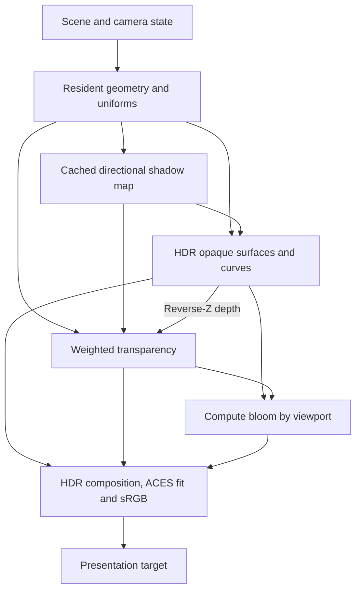

# Uno Platform 7 and WebGPU migration

## Scope

This migration starts at `5c14b18` and is developed in
[PR #18](https://github.com/wieslawsoltes/NurbsScene/pull/18).

The production Uno desktop and WebAssembly applications now use Uno Platform 7
and its WebGPU compositor. Their CAD viewport, graph canvas, icons, overlays,
paths and text all draw through WebGPU. The application dependency graph has no
SkiaSharp runtime package, GL canvas, GL framebuffer readback bridge or
Silk.NET.OpenGL reference.

The independent npm graphics package now also uses WebGPU and the same production
WGSL shader sources. Its WebGL2 implementation and automatic fallback are removed;
legacy entry points report migration guidance. Its validation harness uses ordinary
DOM/SVG controls and remains separate from the Uno application. Exact binary64 NURBS
authoring, document history, parametric solving, picking and interchange are preserved.

## Pinned platform and supported heads

| Component | Version / selection |
|---|---|
| Uno SDK | 7.0.5 in `global.json` |
| Uno UI, compositor and WebGPU canvas | 7.0.32, resolved by the SDK |
| Silk.NET.WebGPU | 2.23.0 |
| Target frameworks | `net10.0-desktop`, `net10.0-browserwasm` |
| App and Controls Uno features | `WebGpu` |
| Native host selection | WebGPU provider before Win32, X11 and macOS hosts |
| Browser host selection | WebGPU provider before WebAssembly host |
| Custom 2D fonts | Bundled DejaVu Sans 2.37 regular, bold, oblique and bold oblique |

WebGPU support is a real runtime requirement. An unsupported browser/driver must
report unavailability; this application does not silently substitute the former
renderer. The project retains its existing desktop and browser heads; it does not
introduce Android, iOS or WinAppSDK targets.

Uno currently documents its WebGPU backend as experimental. The SDK and runtime
versions are pinned together to keep the canvas, compositor and native API shim
compatible.

## Render architecture



The Uno path borrows the presentation target and device from the compositor; the
reusable browser package owns its WebGPU device and canvas context. Capture is an
explicit asynchronous copy request, outside normal presentation.

`CadViewport` derives from `WebGpuCanvasElement`. It passes the context's borrowed
API, device, queue and target view to the reusable `WebGpuRenderer`. The renderer
does not create a second device or request an independent browser context. It
never releases Uno-owned handles and never retains the target view after a frame.

| Pass | GPU resources and behavior |
|---|---|
| Shadow | 2048 × 2048 depth32float map; directional light; caster bias; clip plane; refreshed after geometry/caster/clip/light changes |
| Environment | Authored HDR image; 128 × 128 RGBA16F GGX cube with eight mips; nine diffuse SH coefficients; 128 × 128 DFG lookup; uploaded once |
| Opaque | RGBA16F HDR, four samples; depth32float reverse-Z, near = 1 / far = 0; depth clear = 0 |
| Curves and isocurves | Six-vertex instanced ribbons; pixel-width expansion; analytic coverage; depth test; homogeneous near clipping |
| Ghosted and alpha surfaces | Four-sample RGBA16F weighted accumulation plus R8 revealage; opaque depth read-only; independent blending |
| Bloom | Half-resolution soft-threshold extraction from opaque plus transparent HDR and two separable compute blur passes |
| Presentation | Linear HDR transparency composition, bloom, ACES curve fit and one output transfer conversion |
| Requested capture | Separate composite target, GPU-to-staging copy, asynchronous mapping, padded-row removal and RGBA normalization |

Both rendering and postprocessing respect the four CAD viewport partitions.
Bloom filters are clamped within their viewport, including odd dimensions and
two-pixel separators; maximizing a viewport selects the single-view path.

### Materials and lighting

The surface shader evaluates GGX/Trowbridge-Reitz normal distribution, correlated
Smith visibility and Schlick Fresnel with metallic and roughness parameters.
Three directional lights combine with a sampled HDR studio environment. Offline
GGX roughness mips, diffuse spherical harmonics and a correlated-Smith DFG lookup
provide image-based lighting without per-frame convolution. Surface color is
decoded to linear light before shading. The [environment format and integration
guide](WEBGPU-ENVIRONMENT.md) documents the authored image, equations, reproducible
bake, shared payload and numerical checks.

The directional shadow uses comparison sampling with a weighted nine-position
kernel and a slope-aware receiver bias. Clipped surfaces also clip in the shadow
pass. Two-sided CAD surfaces are supported; derivative normals cover degenerate
display normals without propagating invalid values.

`WebGpuRenderSettings` exposes validated exposure, metallic, roughness, ambient
intensity, key-light intensity, bloom strength, shadow enablement and light
direction. **Tools → Rendering…** exposes validated Apply/Cancel and draft
Revert/Defaults, with persistent preferences. These settings affect display only.

The prefiltered environment uses the split-sum approximation and a single-scatter
microfacet model. The tone mapper is the common ACES response fit, not the complete ACES color-management
pipeline. Weighted blended transparency is order-independent in its accumulation,
but remains an approximation to exact sorted transmission.

### Geometry, precision and performance

Exact geometry and CPU display tessellation remain distinct. The renderer accepts
the existing knot-aware display meshes rather than replacing exact model geometry
with float shader state.

- GPU vertex/index/line buffers are cached by immutable display mesh identity.
  Camera movement, selection and color edits do not upload the geometry again.
- Mesh revisions control GPU synchronization. Selection and color changes update
  packed, adapter-aligned object uniforms.
- World coordinates and camera matrices are prepared in binary64. Scene-relative
  positions are converted to float only for GPU consumption.
- Reverse-Z uses a native zero-to-one projection rather than subtracting a
  float OpenGL depth value near its precision limit.
- Conservative AABB tests reject objects outside all six homogeneous clip planes.
- Four viewports share geometry buffers, pipelines, a shadow map, uniform arenas,
  one command encoder and one ordinary frame submission.
- The regular render path has no CPU framebuffer readback, synchronous queue wait
  or continuously running animation loop. Invalidation drives rendering.
- Exposed diagnostics report frame count, draw calls, triangles, lines, culled
  items, cumulative geometry upload bytes/count, and CPU submission time.
  CPU submission time is not a GPU frame-time measurement.

### Lifetime and capture

Initialization catches failures and releases partial resources because Uno does
not call `OnDestroy` when `Init` fails. Resize replaces owned targets, and
unload disposes every owned buffer, view, texture, bind group, sampler and pipeline.
A reloaded element starts with new device resources.

Capture is explicit and limited to one request in flight. Normal frames never map
a buffer. Copies use 256-byte row alignment and normalize BGRA source channels to
the existing RGBA capture contract.

Native map callbacks need the device owner to make progress. While capture is
pending, a 16 ms dispatcher timer invalidates the viewport so Uno can perform its
normal nonblocking device poll. The timer stops on completion, failure or unload;
the default 10-second timeout cancels the map and requests one final retirement frame.
Explicit capture requests may select a finite positive timeout up to 60 seconds;
software-adapter qualification uses that upper bound and records each elapsed wait.
There is no busy wait or application-owned native polling loop. Completion is
marshaled to the UI dispatcher, and a retired request cannot change a reloaded
viewport's diagnostics or stop a newer request.

## Custom 2D vector drawing

`GraphCanvas`, `ViewportOverlay` and `WorkbenchIcon` derive from
`WebGpuVectorCanvasElement`. Its adapter maps existing path, shape, clip,
transform, dash and glyph operations to Uno's public drawing interfaces.

The adapter borrows Uno's shared factory and uses its nested `RenderOffscreen`
path. It then resolves the resulting GPU texture into the canvas target with a
shared `textureLoad` pipeline. This explicit GPU pass handles native BGRA window
formats and RGBA canvas formats without resetting the compositor's outer drawing
session. It performs no CPU raster-canvas fallback or CPU pixel upload.

Retained text measurement, glyph and panel layout caches remain bounded.
Bundled licensed fonts make the browser's default text shaping deterministic and
offline-capable. Font provenance, exact Git blob hashes and license are recorded
under `src/NurbsScene.Controls/Drawing/Fonts`. Font coverage/fallback is documented
in the typography guide; complete coverage of every writing system is not claimed.

The older Skia raster fixtures use an explicit test-only alias symbol. They
continue to qualify the retained-layout algorithms against their original
baseline; they are not the new application's renderer or proof of WebGPU text
visual parity.

## Reproducing qualification

The normal commands use the stock Uno build tasks:

```sh
dotnet workload install wasm-tools
dotnet build src/NurbsScene.App -c Release -f net10.0-desktop -p:NurbsSceneDesktopOnly=true
dotnet run --project tests/dotnet/NurbsScene.WebGpuContracts -c Release
dotnet publish src/NurbsScene.App -c Release -f net10.0-browserwasm -p:NurbsSceneQualification=true
python tools/stage-uno-site.py
```

Production shader execution, independently of the Uno host:

```sh
python -m pip install playwright
python -m playwright install --with-deps chromium
python tests/browser/test_webgpu_pipeline.py --software

python -m pip install -r tests/gpu/requirements.txt
python tests/gpu/qualify_native_pipeline.py
```

The Uno workflow keeps all ten existing UI campaigns mandatory. They consume the
same built artifact, record its exact commit/tree and publication hashes, and
must identify a real WebGPU device/backend. The dedicated WGSL job creates and
executes the production shader pipelines and checks actual pixels, clipping,
depth, transparency order, shadows, bloom, resizing and viewport isolation.
Software-adapter results are labeled separately from physical-GPU performance.

The separate npm compatibility workflow pins Ubuntu 24.04 because its retained
Playwright 1.57 dependency does not support the current Ubuntu 26.04 runner.

## Evidence and migration journal

1. The migration branch and draft PR were opened from `5c14b18`.
2. Uno 7 hosts and the canvas lifecycle were committed first. Both desktop and
   browser dependency restores resolved the pinned versions with no SkiaSharp
   dependency in the Uno app graph.
3. The renderer, vector UI and shader work were built in stages. The rendering
   library compiled with zero warnings/errors, the complete desktop app built,
   five render-math contracts passed, 28 artifact gate contracts passed and
   22 retained-typography baseline contracts passed.
4. Fifteen native shader/pipeline/readback checks passed on llvmpipe, a CPU
   adapter using an OpenGL backend through wgpu-native. These results established
   shader correctness; they are not hardware-performance or Uno-host evidence.
5. The execution workspace became unavailable before all implementation commits
   were uploaded. Source was recovered from the editing history into GitHub blobs
   and published as new commits; font binaries were recovered from the licensed
   upstream 2.37 distribution with recorded hashes.
6. The reconstructed revision `fc7f2f18` passed the real desktop build, the five
   math contracts and the Chromium production-WGSL pipeline job, including the
   added viewport-partition checks. All ten full Uno interaction campaigns then stopped at the same canvas
   initialization timeout. Their captured console was recovered to diagnose
   the integration failure; those campaigns did not qualify that revision.
7. The unrelated npm workflow runner incompatibility was identified from its
   failure log and corrected without changing its test set or dependency pins.
   Browser device-error observation was strengthened so uncaptured GPU validation
   errors cannot be mistaken for a passing visual campaign. A temporary read-only
   diagnostic workflow exposed the already-captured failing browser console.
8. Review found that a constant clip-space line bias could pull distant curves
   through opaque surfaces under reverse-Z. The bias is now relative, with new
   actual-pixel tests for hidden distant and visible coplanar curves.

CI results belong to the exact revision they test. Earlier local results do not
qualify subsequently reconstructed source. The PR's current checks and attached
evidence are the authority for the final revision.

## Quality boundary

This is a substantial replacement of the rendering architecture and presentation
pipeline. It is not a measured claim of AAA game-engine visual equivalence.
Physical-device GPU timings, before/after performance comparisons, representative
complex-scene screenshots and a cross-device visual review remain required.
The pipeline does not currently implement ray tracing, scene-reflection probes,
temporal antialiasing, screen-space ambient occlusion or GPU NURBS
tessellation. Existing geometric/parity limitations remain in the compatibility
inventory.

## Primary implementation references

- [Uno 7 migration guide](https://platform.uno/docs/articles/migrating-to-uno-7.html)
- [Uno WebGPU backend](https://platform.uno/docs/articles/features/using-webgpu-rendering.html)
- [WebGpuCanvasElement](https://platform.uno/docs/articles/controls/WebGpuCanvasElement.html)
- [Pinned Uno SDK](https://www.nuget.org/packages/Uno.Sdk/7.0.5)
- [Stable Uno canvas source](https://github.com/unoplatform/uno/tree/7.0.32/src/AddIns/Uno.WinUI.Graphics3DWebGpu)
- [Stable drawing backend](https://github.com/unoplatform/uno/tree/7.0.32/src/Uno.UI.Composition.WebGpu)
- [WebGPU specification](https://www.w3.org/TR/webgpu/)
- [DejaVu 2.37 release](https://github.com/dejavu-fonts/dejavu-fonts/releases/tag/version_2_37)


## Follow-up integration journal

### Browser integration diagnosis

The failing full-app console showed a device loss immediately after Uno imported
its WebGPU device and initialized the compositor: "A valid external Instance
reference no longer exists." Standalone offscreen WGSL execution on the same
software adapter passed. The behavior and launch arguments match
[Chromium issue 575926500](https://issues.chromium.org/issues/575926500), whose paired
reproduction distinguishes failing forced-adapter canvas interop from a coherent
SwiftShader Vulkan configuration.

The Uno CI campaigns now use the report's working software launch configuration:
`--enable-unsafe-webgpu --use-angle=swiftshader --enable-unsafe-swiftshader --use-vulkan=swiftshader --enable-features=Vulkan`.
Only test-process setup changes; application device ownership, timeouts,
assertions and GPU error observation remain intact. This diagnosis requires the
next complete Uno campaign run to confirm startup and interaction behavior.

At revision `47ae1c89`, the standalone Chromium shader job executed 16 frames
and passed all 21 checks, including both new reverse-Z occlusion regressions.
All three production WGSL modules compiled without messages or validation errors.


### XAML startup font registration

The coherent software driver configuration removed the observed Chromium device loss on `e580c23`, but the shared app still did not reach its first canvas frame. The captured surface was blank across the XAML chrome as well as the canvases. Source review against Uno 7.0.32 identified a separate necessary host fix: the managed browser font provider cannot discover a system default font. Registering fonts only inside the custom vector adapter does not configure XAML `TextBlock` measurement. Both hosts now register `ManagedBackend.CreateFontProvider(BundledFonts.GetDefaultFontBytes())` before application startup, using the same licensed embedded DejaVu Sans font. Release unhandled exceptions are written to stderr, and failed browser qualification reports public loaded/size/initialization state without suppressing exceptions or relaxing the first-frame assertion. Actual resolved font style is read from the font tables so synthetic bold/italic fallback remains correct when a named family returns a regular face. Full browser runtime qualification is rerun after this fix.


### Opaque-scene attachment cost

Opaque and wireframe scenes now use cleared 1×1 accumulation/revealage targets. Full-resolution 4× MSAA OIT targets are created only while transparent surfaces are present; scene or display-mode transitions rebuild and rebind the correct targets without invalidating geometry buffers. The neutral clear pass omits depth, because WebGPU requires matching render-attachment dimensions. The compositor clamps OIT texture loads to each texture's dimensions. This reduces nominal OIT attachment texel storage from 45 bytes per viewport pixel to 45 bytes for opaque-only scenes (about 356 MiB less at 3840×2160, before driver overhead or compression), and removes the corresponding full-size clears/resolves. It is a resource accounting improvement, not an FPS claim.

Two added actual-GPU regressions compare full-size and 1×1 OIT output byte for byte, including opaque geometry and clipped four-view bloom. Native WebGPU qualification passed 21/21 checks on llvmpipe after this change; the browser suite now executes 18 frames and 23 checks. The modified C# renderer also compiled locally; integrated application qualification remains required on the resulting branch head.


### Browser readback and resident-geometry evidence

The font-corrected app initialized its real WebGPU canvas, rendered XAML/vector controls and passed 26 modeling checks in all ten campaigns. It then exposed a browser-only capture failure: a native map callback reported `null function` and the request timed out. The renderer now accepts an optional host readback delegate, and the Uno browser host uses the public `WebGpuJsInterop.MapReadBase64Async` API already used by Uno 7.0.32's `WebGpuDrawingFactory.SnapshotAsync`. This maps the submitted staging buffer through the JavaScript event loop, without reflection or private handle-table access. Native hosts retain the asynchronous C callback path. Both paths validate padded byte counts, remove row padding, handle RGBA/BGRA, cancel outstanding maps and release their owned buffer/texture after completion. Extra native polling frames run only during requested native captures; browser captures progress without those extra frames. Normal presentation still performs no GPU-to-CPU pixel transfers.

Qualification now records cumulative geometry upload counts/bytes and actual draw/triangle/line work before and after camera-only motion. The artifact gate requires a new frame with changed image pixels, unchanged scene/origin/grid state, and exactly unchanged upload counters. CPU submission time is explicitly separate from GPU execution and readback. All 42 artifact-gate contracts passed locally before integration. Source references: [public browser map API](https://github.com/unoplatform/uno/blob/7.0.32/src/Uno.UI.Composition.WebGpu.Init/WebGpuJsInterop.cs) and [Uno snapshot implementation](https://github.com/unoplatform/uno/blob/7.0.32/src/Uno.UI.Composition.WebGpu/WebGpuDrawingFactory.cs).


### First complete pixel and buffer-reuse evidence; pointer input

The `e82b853` typography modeling report passed all 33 assertions on the actual compiled Uno browser app. It recorded 384,655 model-versus-empty pixels and a different camera-orbit image. Cumulative geometry uploads remained exactly 657,264 bytes across 34 upload operations before and after orbit, while frames advanced from 4 to 5 and the renderer submitted 40,960 triangles. The observed browser device reported no errors. These are correctness/residency observations; CPU submission timing is not GPU timing. Evidence is retained in the [e82 browser workflow](https://github.com/wieslawsoltes/NurbsScene/actions/runs/43112186112).

The subsequent native input campaigns exposed a new canvas hit-test requirement. Uno 7's `WebGpuCanvasVisual` inherits `BorderVisual`: `IsViewHit` allows traversal, but hit containment needs a background or border shape. The CAD and vector canvas constructors now set a transparent background so their real visual bounds can receive pointer input. This uses ordinary public XAML properties. Captures also re-invalidate a browser canvas only until its requested copy is encoded; no extra browser frames are requested while mapping is pending. The unchanged 10-second capture deadline now reports whether it was waiting for viewport submission or buffer mapping, making any remaining failure diagnosable. Qualification saves an initial real app screenshot after the modeling/readback gate, before input campaigns change the workspace.


### Complete reusable graphics migration

The separate `@nurbsscene/graphics` renderer has been rewritten around the same three authoritative WGSL modules. It now owns the corresponding reverse-Z, HDR/MSAA, shadow, curve, weighted-transparency, compute-bloom and tone-mapping resources through the browser WebGPU API. Geometry remains resident across camera changes, opaque scenes use compact neutral OIT targets, and asynchronous captures retain their own dimensions and padded buffers across resize. Initialization failures and device loss are explicit. The former WebGL2 module is a throwing migration shim; no GL rendering or GLSL remains in it.

`packages/graphics/generate-shaders.mjs` emits distributable JavaScript strings and SHA-256 provenance directly from `src/NurbsScene.Rendering/Shaders/*.wgsl`. The new Node contract suite verifies every generated byte and mathematical/API migration contracts (8/8 local checks passed). The mandatory GPU CI job additionally builds the real kernel, preserves the existing package NURBS framebuffer/orbit/four-view assertions, and exercises package depth, OIT, shadows, clipping, rebasing, resizing, near-plane curves, partitioned bloom and explicit capability failure on real browser GPU objects. Local Chromium process creation was blocked by the execution environment, so integrated browser results must come from the hosted CI run; no mock result is substituted. The [package guide](../packages/graphics/README.md) documents the API changes and rendering limits.


### Verified reusable GPU campaign and remaining integration diagnostics

At `d0c2a935`, both the mandatory GPU job and the existing JavaScript workflow passed. The reusable renderer executed 27 frames and 32 distinct assertions on Chromium/Google SwiftShader, with no shader messages or GPU/page errors. Its real NURBS workbench changed 30,887 pixels versus empty output and 11,491 pixels after orbit. Reversed OIT submission differed by at most one channel byte; visible shadow and near-plane ribbon checks passed. The existing workflow retained 12 native, 68 Node and 12 offline UI tests, plus isolated consumption of all six tarballs. [GPU artifact](https://github.com/wieslawsoltes/NurbsScene/actions/runs/43114369425/artifacts/13896939998).

Six full Uno input campaigns passed at `66f96ad`: workspace, panels, typography, panel display, panel edges and panel scrolling. Three campaigns reached their first submitted map but exceeded the 10-second capture deadline, without a GPU or page error. Rhino-style command entry still lost its prefix. These are recorded failures, not qualified passes. The next diagnostic batch uses a separate explicit 60-second capture budget only for qualification, retains the normal 10-second default, and records each capture's phase, end-to-end duration and byte count. Passive native `GPUBuffer.mapAsync` timing preserves the returned promise and exposes whether the GPU promise or managed continuation is delayed; failed maps remain mandatory error evidence. The input observer records a bounded passive key/character/focus/text timeline. Functional assertions, all ten campaigns, and exact source/publication checks remain required.

Visual review also found that XAML's typography-dialog preview used the regular fallback while the custom panel used the actual bold/italic face. The global public `IFontProvider` now chooses among the four licensed embedded DejaVu faces, retains normal installed-family matching, and bounds its exact-size fallback cache. This corrects the host font source rather than changing the requested font style or hiding the preview. Runtime visual acceptance is rerun with this provider.


### Native map cancellation lifetime review

Independent review against Uno 7.0.32's pinned wgpu-native implementation found that destroying a pending native buffer map can invoke its abort callback synchronously. Cleanup now records successful mapping ownership, skips unmap for failed/aborted maps, marks destruction before entering native code and defers handle release until the outer destroy wrapper returns. This avoids both an invalid second unmap and premature release during Uno's map-state bookkeeping. Browser mapping remains owned by the public async bridge. This correction is supported by the pinned [wgpu-core map-state implementation](https://github.com/gfx-rs/wgpu/blob/v29.0.3/wgpu-core/src/resource.rs) and [Uno's Silk compatibility wrapper](https://github.com/unoplatform/uno/blob/7.0.32/src/Uno.UI.Composition.WebGpu.Init/SilkCompat/SilkCompat.Hand.cs); native hardware cancellation qualification remains separate from browser correctness.


### Command entry under delayed focus

The passive `c93a131` input trace isolated the remaining Rhino-style shell failure. Characters accumulated correctly in a canvas draft, but the queued text focus took approximately 830 ms to run in the software-rendered session. Each Space was still routed as a canvas repeat action, clearing the draft; the actual character event then discarded its whitespace. No delayed query-clear callback appeared in that failing interval.

Space now preserves an active transfer draft and its text comes from the actual layout-aware `CharacterReceived` event. Enter submits that pending draft through the normal command path. Space/Enter with no pending draft retain the existing repeat behavior. The regression campaign keeps its original exact-prefix test and adds fast native typing followed immediately by Enter, then an ordinary Undo; it does not force focus, slow typing, retry input or invoke a command test hook. The Rhino minimum rises from 56 to 58 checks and the ten-campaign UI minimum from 349 to 351, retaining every prior assertion.

The same `c93a131` run passed the other nine complete Uno input campaigns. Its styled XAML typography preview was visually checked and now uses the real bold-oblique face. Measured completed captures show native software-GPU mapping occupying most of the elapsed readback time; no evidence justified changing managed continuation dispatch.


### Measured integrated browser capture behavior

All ten campaigns associated with branch head `c93a131c` completed their 330 modeling checks and all 30 real staging-buffer maps. No observed GPU or page error was reported. The identical 849-file publication manifests bind those runs to PR merge commit `d37bf6b5f82f1af950389dc65a4507de502fbc6d`, tree `5efec4bf28ca24cfbb2ec9c2278019edf4ae4d80`; a branch head and the actual Actions merge checkout are recorded separately.

The largest native map wait was 8,803.4 ms. The largest complete capture took 10,622.8 ms, including an 8,696.4 ms native map. This establishes that a real software-rendered capture can exceed the old 10-second total qualification budget even when its native map itself completes within 10 seconds. All maps returned 4,601,856 padded bytes and all captures produced 4,410,112 RGBA bytes. Every camera sample retained the same 657,264 cumulative upload bytes and 34 upload operations. These are measured correctness and residency results, not GPU timestamp measurements or target-device latency guarantees. [Associated workflow and per-campaign artifacts](https://github.com/wieslawsoltes/NurbsScene/actions/runs/43117274921).

### Real native desktop qualification

The existing desktop CI job now builds an opt-in native qualification hook and runs the actual Uno X11 host under Xvfb using Mesa Lavapipe's Vulkan adapter. It verifies Uno's own adapter initialization log, solves the existing Pavilion definition, captures empty/filled/orbited framebuffers through the public asynchronous viewport API, checks changed pixels and unchanged geometry residency, writes three PPM images plus JSON evidence, and closes the window normally. No renderer, native callback, shader or driver is replaced by a test implementation.

Each capture uses an explicit 60-second qualification budget and 65-second outer wait, with phase/status/elapsed evidence; ordinary application calls retain their 10-second default. The process has a 420-second hard deadline. The workflow rejects missing evidence, the wrong tested commit, unexpected GPU errors, failure to close, or an adapter other than the selected Vulkan CPU backend. This adds native asynchronous map success and completed-resource teardown evidence; it does not claim in-flight cancellation coverage, physical-GPU performance, or validation of every desktop OS. Reproduction and artifact locations are in [BUILD.md](BUILD.md#real-native-desktop-qualification).


### Verified native host execution

The native desktop job passed at branch head `ccb2e64d`: 17 assertions, zero compiler warnings/errors, and normal window closure. Uno reported `llvmpipe (LLVM 21.1.8, 256 bits)`, `backend=Vulkan type=Cpu`, and `Bgra8Unorm` presentation. All three requested 712 × 524 captures completed through the production native mapping path. Empty-to-filled comparison changed 133,198 pixels; perspective orbit changed 13,645. Camera motion advanced frames from 6 to 7 while preserving scene revisions, origin, mesh identities, 657,264 cumulative uploaded bytes and 34 upload operations; both measured frames submitted 40,960 triangles.

The three capture durations were 136.7873, 271.9911 and 197.7404 ms. These are complete software-rendered capture waits, not GPU frame times. The report records `windowClosed=true`, the process returned normally, and the runtime log contains no device-loss, uncaptured GPU-error or managed-error event. Final gate review therefore removes all native device-loss exemptions: any such message fails this qualification.

The tested Actions merge commit `0e500d783e2cc1857a89b42ff852ce909102a455` and `ccb2e64d` have the identical tree `ca483be5e3efdc92f20f5952bb28154dd32e042d`. The [native artifact](https://github.com/wieslawsoltes/NurbsScene/actions/runs/43119911370/artifacts/13899708317) contains the JSON, adapter log and original PPMs; its ZIP SHA-256 is `aac2e95e6ba937d6a199e757168d3d031515e8f81284344d38c0ba5982c51df0`. Reconstructed RGBA bytes from every PPM match the capture hashes. Visual review confirmed the expected four-view geometry, shading, curves, partitions and normalized colors. This executes the real Uno native host, separately from the earlier standalone wgpu-native shader harness.


### Verified command handoff and native resize acknowledgment

At `d204d956`, the Rhino shell campaign passed its original character-preservation test, the new immediate-Enter command, its ordinary Undo, command repeat, keyboard ownership, model navigation and inspector resizing. It completed 38 assertions before failing the narrow-window check. Nine other complete browser campaigns passed.

The saved failure snapshot explains that last result: after Playwright requested a 680 × 1050 browser viewport, the observer still reported the old native workspace at 1600 × 1100, with the inspector splitter at x = 1288. The production layout correctly bases its responsive visibility on native `ActualWidth`; two newer generic observer samples did not acknowledge that resize. Both narrow and wide transitions now wait, with the existing bounded observation helper, for the actual requested native width and height before evaluating the unchanged collapse/restoration assertions. The subsequent 680 × 1050 failure screenshot already shows the inspector and splitter correctly absent, confirming the production resize completed after the sampled assertion. No production layout preference, threshold, input action, or assertion is relaxed, and no fixed delay is added. [Original failed campaign evidence](https://github.com/wieslawsoltes/NurbsScene/actions/runs/43119105518/artifacts/13900602622).


### Complete application qualification and navigation evidence

All 23 workflows passed at `e5bb9abc`, including the 14-job Uno workflow and its all-campaign aggregator. The ten isolated browser campaigns passed 351 UI checks and 33 initial modeling checks each (330 executions) against the identical 849-file publication. The actual Actions merge commit was `6dc0b94f5b3861cd938b938a6f02f7b00f582864`, with tree `8e6a0cbc6dd1f672c7a36617eec28cf5c2f4ca26`, identical to that branch head's tree. [Aggregate evidence](https://github.com/wieslawsoltes/NurbsScene/actions/runs/43122105304/artifacts/13902460385) and [qualified application](https://github.com/wieslawsoltes/NurbsScene/actions/runs/43122105304/artifacts/13900939636) are retained by CI.

The primary 30 browser captures completed, with maximum observed end-to-end wait 10,274.6 ms and maximum native map wait 8,887.0 ms. The shell campaign's persisted-state reload also completed three further maps in its new document; those are kept distinct from the initial 30 capture samples. The final four-view model, native viewport editor, typography preview and GPU graph text were visually reviewed. The native desktop, standalone shaders, reusable package and existing numerical/graph/interchange suites also passed on this source.

Final evidence review found one navigation-lifetime gap: the shell's page reload replaces its document-local GPU observer, so its clean new device state cannot prove the preceding interaction session was error-free. The campaign now saves `uno-rhino-pre-reload-gpu.json` and applies the same strict device-observation predicate immediately before navigation. The aggregator requires and validates that checkpoint, and retains it with the full campaign evidence. Two negative artifact contracts reject a missing checkpoint or an earlier device error followed by a clean reloaded device. All 351 UI checks and all application behavior remain unchanged. The 51 artifact contracts and 47 existing observation contracts pass locally; the next exact-source CI run additionally qualifies the retained first-document state.

### Continuation review: local camera precision

Independent review found that both camera implementations added the local orbit offset to the world-space target before subtracting the display origin. At sufficiently large coordinates that first addition rounds away a small camera distance, even though the eventual view transform is origin-relative. `Camera.Basis(origin)` and its JavaScript counterpart now subtract the origin first. Reverse-Z transforms, the existing public projection matrix and point projection use this order consistently. Shadow and visibility bounds likewise subtract the origin before averaging their endpoints, avoiding a rounded world-space midpoint.

The new contracts compare all four camera modes at distances of 0.001, 7.25 and 125 against translations of up to 10^16 units. They also check a visible box whose world-space midpoint cannot be represented and verify shadow-matrix translation invariance. The seven C# WebGPU math contracts and two new JavaScript precision contracts pass locally. This preserves local camera arithmetic; it cannot recover detail already lost when an application's authoritative binary64 world geometry was created.

### Continuation review: BRDF, transparency and cache correctness

The shader now honors the public perceptual-roughness range [0.04, 1]. Review found both a hidden 0.075 clamp and a fixed denominator floor that reduced the aligned GGX peak at roughness 0.075 from approximately 10,060 to 31.64. The repaired distribution uses `|N × H|² + alpha² (N·H)²`, avoiding subtractive cancellation and preserving the true smooth peak. Correlated Smith visibility likewise retains its valid grazing behavior. The final shaded radiance remains bounded before half-float attachment writes. The [Filament derivation](https://google.github.io/filament/main/filament.html) describes the stable cross-product formulation and visibility model.

Bloom extraction now resolves opaque color and weighted transparency at each downsample tap. Transparent highlights therefore contribute to the same bloom as opaque ones, including depth occlusion and viewport boundaries. Both backends bind accumulation/revealage to the compute pass and rebuild those groups when opaque-only 1×1 OIT targets transition to full size or back. This adds no full-resolution HDR intermediate.

The native renderer no longer submits Ghosted surfaces as opaque shadow casters. Shadow invalidation follows geometry, caster membership, clipping, effective shadow enable and normalized light direction; selection, exposure, bloom and material edits no longer redraw that depth map. Object uniforms track material changes separately from postprocessing. Cumulative shadow-pass, caster-draw and material-upload diagnostics make these behaviors observable. Pure curves remain conservatively visible until GPU ribbon clipping so their screen-space width is not removed at an AABB boundary. Frame eye uniforms now use the corrected origin-relative camera basis.

Static shader-byte parity, eight Node shader/API contracts and syntax checks passed locally. Added actual-GPU probes cover float32 GGX/Smith values, the 0.04/0.075 material distinction, transparent-only bloom, hidden transparent highlights, viewport isolation and OIT target transitions. The local Chromium executable is blocked while creating its Unix-domain process socket (`EPERM`), before any shader executes; the mandatory hosted GPU and native/browser application jobs remain the runtime gate.

### Continuation review: usable settings and resource lifetimes

The application now exposes **Tools → Rendering…** with exposure, bloom, metallic, roughness, ambient/key intensity, shadows and light direction. Draft values are validated before Apply; Cancel, Revert draft and Defaults do not change the live renderer. A separate versioned, invariant JSON preference record persists the applied display settings. Invalid records fall back atomically. `CadViewport.RenderSettings` retains the validated value across renderer initialization and reload, and callers can use the same public validation method as the renderer.

Viewport diagnostics are dispatched after compositor recording and suppressed when the originating renderer lifetime has ended. This prevents subscribers that update command history/text/layout from reentering the compositor while it records a frame. Review also found that the underlying managed installed-font provider retained complete font data for every requested size despite the adapter's local cache bound. Vector fonts now resolve a physical face once at a canonical size; metrics, shaping positions and GPU draw transforms scale consistently to the requested size. Continuous zoom therefore does not populate an unbounded installed-font size cache.

Qualification adds four managed preference contracts and six real native-control assertions in the existing Rhino browser campaign, including invalid drafts, Apply, Revert, Cancel and persistence through its existing reload. The registry minimum becomes 64 Rhino checks and 357 across all ten UI campaigns; previous assertions and the pre-reload GPU checkpoint remain mandatory. The 51 artifact contracts pass locally.

Native qualification adds 13 actual-frame cache assertions, seven pending-map lifetime/recovery assertions and three font metric/resolution assertions, for 40 total. The capture probe runs in a real `WebGpuCanvasElement` on Uno's borrowed device, requires a genuinely pending map before cancellation/disposal, validates cancellation or a complete readback that wins the race, recovers with the same renderer or a replacement on that device, compares the resulting opaque pixels and unloads normally. Cache checks observe real frame advancement without adding full-size readbacks. Font checks compare four actual faces with independently sized managed fonts, then exercise 512 size changes per face and an installed family while requiring one physical resolution. Hosted App compilation/runtime remains required: local .NET libraries compile, but Uno's separate MSBuild resource-injection task host is blocked by this workspace's IPC restrictions (`MSB4216`).

### Native qualification: completion versus cancellation

At `5c0d712`, both desktop compilation and browser publication passed. The actual native run passed the original 17 image/model assertions, all three font assertions and all 13 cache assertions. The new lifetime probe advanced past a successful `CancelCapture` cancellation, then observed a valid completed readback after disposal began with the task still pending. Its initial test incorrectly required disposal cancellation to win. The production capture code was unchanged: its completion and cancellation paths serialize on the request gate, and native callbacks may run spontaneously.

The corrected probe accepts only the two legal terminal outcomes for each operation: its documented cancellation exception or complete opaque pixels exactly matching both recovery captures. It records `CancelOutcome` and `DisposeOutcome`, including byte counts and SHA-256 when completion wins. Pending-before-call, idempotent repeated calls, same-device recovery, exact pixels and normal unload remain mandatory. There are no retries or timing delays. Evidence distinguishes observed map abortion from a successful completion race; one is never presented as the other. [Original native/build evidence](https://github.com/wieslawsoltes/NurbsScene/actions/runs/43167225399).

### HDR environment integration and final numerical review

Both production renderers now upload and sample the same original HDR studio environment: a 128px RGBA16F cube with eight GGX roughness mips, nine cosine-convolved diffuse SH coefficients and a 128px correlated-Smith DFG lookup. Its decoded payload SHA-256 is `8a72c9015e07baaaaec137b69322f4f48e5df448d2a24740c6bef55df0c03c21`. The native assembly embeds the canonical gzip file; the standalone npm module embeds those exact compressed bytes and needs no runtime fetch. All convolution is offline, with one upload per renderer and normal owned-resource teardown. The [environment guide](WEBGPU-ENVIRONMENT.md) documents the source image, equations, binary/cube conventions, costs and approximation limits.

The reproducible baker retains uniform radiance under GGX filtering, reconstructs constant diffuse irradiance, checks finite HDR and bounded single-scatter DFG, and compares selected LUT texels with independent 65,536-sample integrations. Byte-for-byte rebaking and three asset/provenance contracts passed locally. The mandatory GPU job now repeats the bake with pinned NumPy, then validates actual cube direction, roughness response, white diffuse normalization and metallic white-furnace behavior. Its package campaign also produces a 960 × 540 contact sheet from six untouched production sphere/floor captures, spanning dielectric/metallic materials and roughness 0.08/0.32/0.8. A seventh environment-disabled capture establishes differential lighting, while all seven must retain identical geometry buffers and one cached shadow pass. These procedural fixtures qualify display behavior and support visual review; they are not an exact modeling or hardware-performance benchmark.

Final numerical review also found that a valid binary64 clipping plane could overflow when copied directly into Float32 uniforms. Both hosts now normalize the half-space safely before rebasing, preserving equivalent equations scaled from 1e-100 through 1e300. Nonrepresentable normalized/relative offsets fail explicitly before submission. Finite nonzero light directions normalize without length overflow or reciprocal underflow. The ten C# render-math contracts, 16 Node graphics contracts, 49 managed presentation contracts and 51 artifact-gate contracts pass locally; the final hosted workflow establishes integrated runtime acceptance.

### Integrated lighting and native lifetime acceptance

At branch head `665e8216d6ac624e996f531e2c7cbd05059e5f20`, the [hosted Uno run](https://github.com/wieslawsoltes/NurbsScene/actions/runs/43168359356) passed desktop compilation with zero warnings/errors, all 40 native assertions, all 43 canonical WGSL checks over 25 frames, the reusable package's 85 checks, and the material showcase's 12 checks over seven frames. The tested PR merge commit `2b6ddd1a71bf8cbeb983f4a870b89aff97dc31a0` has tree `2471d1e932415b56eb01e7eb30b6f2d1179a9d5a`, exactly matching that branch head. Application input campaigns are a separate gate and were still under review at this checkpoint.

Both actual native abort branches were observed: `CancelCapture` produced `OperationCanceledException`, and disposal produced `ObjectDisposedException`, with both tasks pending immediately before the call. Each recovered renderer submitted 10,240 triangles and returned 81,920 opaque bytes at 160 × 128; the two recovery captures had identical SHA-256 `A96BCC812BA7591AFE6C83135BF5BF49F28CAAD386EE58354D2F21474EA795B9`. The canvas unloaded and the application window closed normally. The primary native model captures changed 133,206 surface pixels and 14,277 camera pixels while retaining 657,264 geometry-upload bytes and 34 upload operations. [Native evidence](https://github.com/wieslawsoltes/NurbsScene/actions/runs/43168359356/artifacts/13920693104).

The six unmodified production material captures were visually reviewed: identifiable softbox reflections broaden across roughness 0.08, 0.32 and 0.8, with distinct dielectric/metallic responses and coherent receiving shadows. All seven captures retained two geometry uploads and one shadow pass. Disabling environment lighting changed 13,908 comparison-region pixels; roughness changed 11,175 dielectric pixels and 13,647 metallic pixels. The [GPU artifact](https://github.com/wieslawsoltes/NurbsScene/actions/runs/43168359356/artifacts/13921027256) contains the image and JSON; its ZIP SHA-256 is `7adf3c4714840ebf481e233b32d8265d31030238e63b206452d814ff756c5094`, and the contact-sheet PNG SHA-256 is `86fa9cc8c1009e63df952dfe0345fec9105eb878a9c87304497d90999eec4d0f`. These software-adapter runs establish rendering correctness, cache behavior and reviewed appearance, not physical-GPU frame-rate or AAA-engine equivalence.

### Rapid selection followed by dragging

The native workspace campaign exposed a graph gesture ordering defect: Uno can raise `DoubleTapped` on the second press, before its pointer release. A fast selection followed by a drag therefore opened the slider dialog, stealing capture before the drag's move events. Dispatching the modal action through the dispatcher did not ensure the pointer had released. The inputs/sliders campaign independently encountered the same immediate-drag failure after sub-threshold jitter.

The canvas now retains the recognized double-tap action until the owning left pointer releases without crossing the existing two-DIP movement threshold. Movement, pointer cancellation, capture loss, graph replacement and disposal discard it. Release coordinates are checked even if the host coalesced the final move. Activation happens after capture and gesture cleanup, retains the original graph/node/modifiers, and cannot target a replacement graph. Hosts that recognize `DoubleTapped` after release retain immediate activation. The original real-input drag, slider, typography and pointer-selection assertions remain unchanged; the final full application run must qualify this correction.
